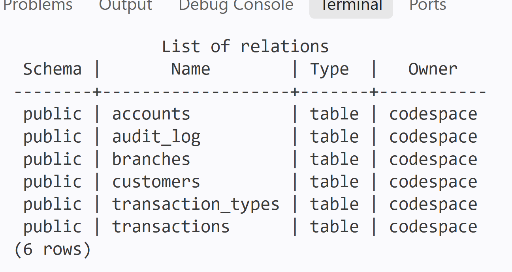
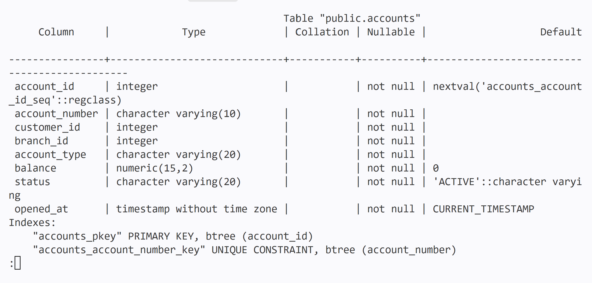
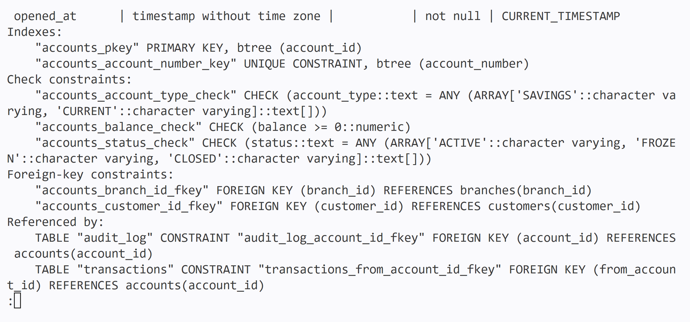

# SamyPay Database Design

## 1. Entities
| Table | What it stores |
|---|---|
| branches | The SamyPay branches |
| customers | People registered with SamyPay |
| accounts | The savings and current accounts customers own |
| transaction_types | The kinds of transaction (deposit, withdrawal, transfer, reversal) |
| transactions | Every movement of money |
| audit_log | A record of every balance change |

## 2. Attributes and Keys

**branches**
| Field | Type | Key | Required |
|---|---|---|---|
| branch_id | SERIAL | PK | Yes |
| branch_name | VARCHAR(100) | | Yes |
| city | VARCHAR(100) | | Yes |

**customers**
| Field | Type | Key | Required |
|---|---|---|---|
| customer_id | SERIAL | PK | Yes |
| first_name | VARCHAR(50) | | Yes |
| last_name | VARCHAR(50) | | Yes |
| email | VARCHAR(100) | Unique | Yes |
| phone | VARCHAR(20) | | No |
| date_of_birth | DATE | | Yes |
| created_at | TIMESTAMP | | Yes (default: now) |

**accounts**
| Field | Type | Key | Required |
|---|---|---|---|
| account_id | SERIAL | PK | Yes |
| account_number | VARCHAR(10) | Unique | Yes |
| customer_id | INT | FK to customers | Yes |
| branch_id | INT | FK to branches | Yes |
| account_type | VARCHAR(20) | Check: SAVINGS or CURRENT | Yes |
| balance | NUMERIC(15,2) | Check: not below 0 | Yes (default: 0) |
| status | VARCHAR(20) | Check: ACTIVE, FROZEN or CLOSED | Yes (default: ACTIVE) |
| opened_at | TIMESTAMP | | Yes (default: now) |

**transaction_types**
| Field | Type | Key | Required |
|---|---|---|---|
| type_id | SERIAL | PK | Yes |
| type_name | VARCHAR(20) | Unique | Yes |

**transactions**
| Field | Type | Key | Required |
|---|---|---|---|
| transaction_id | SERIAL | PK | Yes |
| type_id | INT | FK to transaction_types | Yes |
| from_account_id | INT | FK to accounts | No (empty for deposits) |
| to_account_id | INT | FK to accounts | No (empty for withdrawals) |
| amount | NUMERIC(15,2) | Check: above 0 | Yes |
| status | VARCHAR(20) | Check: PENDING, SUCCESS, FAILED or REVERSED | Yes (default: PENDING) |
| created_at | TIMESTAMP | | Yes (default: now) |

**audit_log**
| Field | Type | Key | Required |
|---|---|---|---|
| audit_id | SERIAL | PK | Yes |
| account_id | INT | FK to accounts | Yes |
| old_balance | NUMERIC(15,2) | | Yes |
| new_balance | NUMERIC(15,2) | | Yes |
| changed_at | TIMESTAMP | | Yes (default: now) |

## 3. Relationships
| Tables | Type | One direction | Other direction |
|---|---|---|---|
| customers and accounts | One to many | A customer can have none, one or many accounts | An account belongs to one customer |
| branches and accounts | One to many | A branch can hold none, one or many accounts | An account belongs to one branch |
| accounts and transactions (sender) | One to many | An account can send none, one or many transactions | A transaction has one sender, or none for a deposit |
| accounts and transactions (receiver) | One to many | An account can receive none, one or many transactions | A transaction has one receiver, or none for a withdrawal |
| transaction_types and transactions | One to many | A type can be used by none, one or many transactions | A transaction has one type |
| accounts and audit_log | One to many | An account can have none, one or many audit entries | An audit entry belongs to one account |

No linking table is needed because every account has only one owner. A transfer involves two accounts, so `transactions` has two foreign keys to `accounts`.

## 4. Business Rules and Constraints
| # | Rule | How it is enforced |
|---|---|---|
| 1 | Customer emails are unique | UNIQUE and NOT NULL on `email` |
| 2 | An account has one customer and one branch | NOT NULL foreign keys `customer_id` and `branch_id` |
| 3 | Account numbers are unique | UNIQUE and NOT NULL on `account_number` |
| 4 | Balance cannot go below zero | CHECK (balance >= 0) |
| 5 | Transaction amount must be above zero | CHECK (amount > 0) |
| 6 | Only active accounts can send or receive money | A key can't do this. The transfer code must check that both accounts have status ACTIVE before moving money |
| 7 | A transfer is complete or it does not happen | A key can't do this. The debit, credit and transaction record are put in one transaction (BEGIN ... COMMIT) |
| 8 | A failed transaction leaves balances unchanged | ROLLBACK, and the transaction is saved with status FAILED |
| 9 | Every transaction records type, amount, status and date | NOT NULL on those columns |
| 10 | Reversed transactions are marked, not deleted | A key can't do this. Delete permission is removed on `transactions`, and a reversal changes the status to REVERSED |
| 11 | Every balance change is logged | A key can't do this. A trigger on `accounts` writes the old and new balance into `audit_log` |

## 5. Design Assumptions
1. Each account has one owner only (no joint accounts).
2. All amounts are in Naira, so there is no currency column.
3. Deposits have no sender and withdrawals have no receiver, so those two columns can be empty.
## Evidence

### Tables created in PostgreSQL

This shows the six SamyPay tables after running schema.sql

### Accounts table structure

This shows the columns, primary key, unique, check and foreign-key constraints on the accounts table
