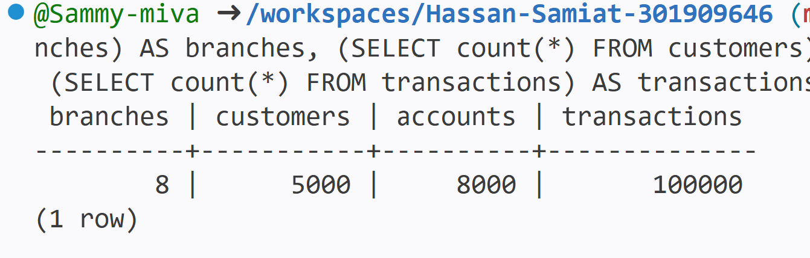

# Portfolio 2: Query Optimisation
## Purpose
This portfolio shows how SQL queries run on the SamyPay database, how I
checked their performance, and how indexes can make them faster. It uses the
same SamyPay database designed in Portfolio 1.

## Environment
- Database: PostgreSQL 16
- Where it runs: GitHub Codespaces (Linux terminal)
- Database name: `samypay`
- Tool used to run SQL: `psql`

## Step 1: Loading sample data
A query only shows a clear speed difference when there is a lot of data to
search through. I wrote a script, `samypaydata.sql`, that fills the database with
simulated data. No real customer information is used.

| Table | Rows loaded |
|---|---|
| branches | 8 |
| customers | 5,000 |
| accounts | 8,000 |
| transactions | 100,000 |
This much data is needed so a speed differnce shows up

The script also adds the four transaction types: DEPOSIT, WITHDRAWAL,
TRANSFER and REVERSAL. Amounts, dates and statuses are generated randomly,
and each transaction follows the SamyPay rules from Portfolio 1, for example
a deposit has a receiving account but no sending account.

### How I ran it
```
psql -d samypay -f portfolio-2-query-optimisation/samypaydata.sql
```

### Checking the result
I counted the rows in each table to confirm the data loaded correctly:
```
SELECT (SELECT count(*) FROM branches) AS branches,
       (SELECT count(*) FROM customers) AS customers,
       (SELECT count(*) FROM accounts) AS accounts,
       (SELECT count(*) FROM transactions) AS transactions;
```



The counts match the numbers in the table above.

### Problem I met
one issue i had when running it for thefirst time, the script ran
twice and the transactions table showed 200,000 rows. I emptied the tables
with TRUNCATE and ran the script once to get the correct counts.
