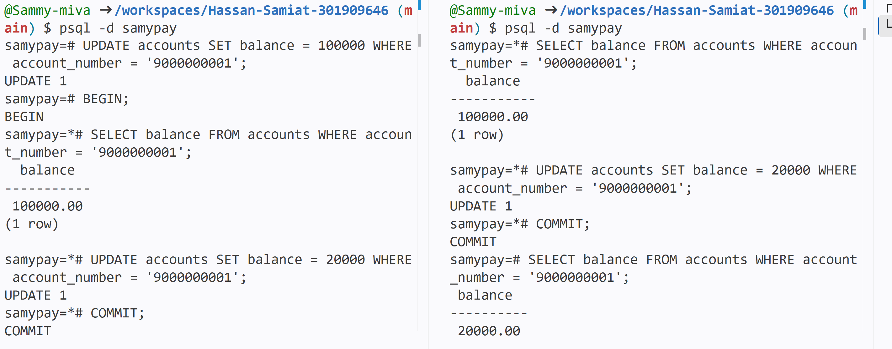

# Portfolio 3: Transactions and Concurrency

## Purpose
This portfolio shows how the SamyPay database keeps money movements safe
using transactions. A transaction groups several steps so that they either
all happen or none of them do. It uses the same `samypay` database designed
in Portfolio 1.

## Environment
- Database:I still made use of the  PostgreSQL 16 in GitHub Codespaces
- Database name: `samypay`
- Tool used to run SQL: `psql`

## Setup: demo accounts
To make the data accurate, i continued with the Portfolio 2 data, I created two demo customers and two demo accounts with known balances (`samypaysetup.sql`).

| Account number | Owner | Starting balance |
|---|---|---|
| 9000000001 | Demo Sender | 100,000 |
| 9000000002 | Demo Receiver | 50,000 |

## Demo 1: successful transfer (COMMIT)
I transferred 30,000 from the sender to the receiver inside one transaction.
It has three steps: debit the sender, credit the receiver, and record the
transfer in the `transactions` table. After `COMMIT`, the balance of the sender became 
70,000 while the receiver's own became  80,000, and the new transaction row was saved.

**What it shows:** all three steps were saved together (atomicity), and the
result stays saved after the commit (durability).

## Demo 2: failed transfer (ROLLBACK)
I tried to transfer 500,000 from an account holding only 70,000. The
receiver was credited first, and then the debit failed because of the rule
`CHECK (balance >= 0)` on the accounts table as the sender's balance was not enough for the transfer. PostgreSQL reported a check constraint error, and I ended the transaction with `ROLLBACK`. Both balances were back to 70,000 and 80,000.

**What it shows:** without a transaction, the receiver would have kept money
that never left the sender. The rollback undid the credit as well, so the
database stayed consistent. This supports business rules 7 and 8 from
Portfolio 1 (a transfer is complete or it does not happen, and a failed
transaction should leave balances unchanged).

## Demo 3: manual ROLLBACK
Inside a transaction I reduced the sender's balance by 10,000. Inside the
transaction the balance showed 60,000. After `ROLLBACK` it returned to
70,000.

**What it shows:** changes made inside a transaction are only temporary
until `COMMIT`, and `ROLLBACK` discards them.

## Results summary
| Step | Sender balance | Receiver balance |
|---|---|---|
| Before | 100,000 | 50,000 |
| After successful transfer (COMMIT) | 70,000 | 80,000 |
| After failed transfer (ROLLBACK) | 70,000 | 80,000 |
| Demo 3 inside the transaction | 60,000 | not changed |
| Demo 3 after ROLLBACK | 70,000 | 80,000 |

## Limitations
- The failed transfer in Demonstration 2 was caught by the CHECK rule on
  the balance. A real transfer procedure should also check that both accounts
  are ACTIVE and that the sender has enough money before changing anything.
- These demonstrations do not yet write to the `audit_log` table, so business
  rule 11 is not enforced yet.
- Running `samypaycommit-rollback.sql` again gives different starting balances,
  because the successful transfer is saved permanently each time.

  ## Concurrency and isolation

Concurrency means two people using the database at the same moment. The classic bank problem is a lost update: two withdrawals each check the balance, both see enough money, and both go through, so the bank pays out more than the account held.Concurrency means two users working on the same account at the same time. A bank has to make sure this never produces a wrong balance. I tested this with two terminals connected to the `samypay` database (Terminal A and Terminal B),
using the demo account 9000000001 with a starting balance of 100,000. I typed
the steps by hand in a fixed order, and the steps are saved in
`samypayconcurrency-demo.sql`

### Part 1: the problem (lost update)
Both sessions started a transaction and read the balance. Both saw 100,000,
so both believed an 80,000 withdrawal was allowed. Session A then wrote a
balance of 20,000 and committed. Session B, still working from the balance it
had read earlier, also wrote 20,000 and committed.

**Result:** the final balance was 20,000. Two withdrawals of 80,000 were
approved (160,000 in total) from an account holding only 100,000, but the
balance dropped by only 80,000, so one withdrawal was lost.

**Why it happened:** both sessions read the balance before either of them
wrote. The `CHECK (balance >= 0)` rule did not help, because 20,000 is a
valid balance. The rule only checks the value being written, not whether it
was calculated from out-of-date information.

### Part 2: the fix (row locking with FOR UPDATE)
This time both sessions used `SELECT ... FOR UPDATE`. Session A read the
balance and locked the row. When Session B ran the same statement, it waited
and did not return a result. After Session A withdrew 80,000 and committed,
Session B immediately received the new balance of 20,000. That was not enough
for another 80,000 withdrawal, so Session B ended with `ROLLBACK`.

**Result:** the final balance was 20,000 and only one withdrawal took place,
which is correct.

**Why it works:** `FOR UPDATE` lets only one session hold the row at a time.
The second session has to wait, so it makes its decision using the current
balance instead of an old one.

### Comparison
| | Part 1 (no lock) | Part 2 (FOR UPDATE) |
|---|---|---|
| Session B read the balance | Immediately | After Session A finished |
| Balance Session B saw | 100,000 (out of date) | 20,000 (current) |
| Withdrawals approved | 2 | 1 |
| Final balance | 20,000 (one withdrawal lost) | 20,000 (correct) |

### Part 3: isolation level (SERIALIZABLE)
In Parts 1 and 2 the sessions used PostgreSQL's default isolation level,
READ COMMITTED. For Part 3 I repeated the clash from Part 1, but both sessions
started with `BEGIN ISOLATION LEVEL SERIALIZABLE`. The account balance was reset
to 100,000 first.

Both sessions read the balance and saw 100,000. Session A then wrote 20,000 and
committed. When Session B tried to write 20,000 on top of it, PostgreSQL
stopped it with this error:

`ERROR: could not serialize access due to concurrent update`

I ended Session B's transaction with `ROLLBACK`. The final balance was 20,000,
and the second withdrawal never took place.

**Why it happened:** at this isolation level, a transaction works from a fixed
snapshot of the data taken when it starts. Session A changed the row after
Session B took its snapshot, so Session B's information was out of date.
PostgreSQL refuses to let a transaction write over a change it never saw,
instead of silently overwriting it as happened in Part 1.

**What the application must do:** the error is not a fault in the database.
It means the transaction has to be tried again. On a retry, Session B would
read the current balance of 20,000 and see that there is not enough money for
an 80,000 withdrawal.

### Comparison of the three approaches
| | Part 1 (READ COMMITTED, no lock) | Part 2 (FOR UPDATE) | Part 3 (SERIALIZABLE) |
|---|---|---|---|
| What happened to Session B | Went ahead with an old balance | Waited for Session A to finish | Received an error after Session A committed |
| Withdrawals approved | 2 | 1 | 1 |
| Final balance | 20,000 (one withdrawal lost) | 20,000 (correct) | 20,000 (correct) |
| Who handles the conflict | Nobody, so the data was wrong | The database, by making B wait | The application, by retrying |
| Main cost | Wrong balances | Waiting time | Retry logic needed |

### Conclusion
Isolation levels and locks protect the data in different ways. Locking
(`FOR UPDATE`) stops a conflict from happening by making one session wait.
SERIALIZABLE lets the sessions run together and stops the one whose
information is out of date. For SamyPay, locking the sender's account at the
start of each transfer is the simpler choice for everyday transfers.
SERIALIZABLE is useful for operations that read several rows and make
decisions from them, as long as the application retries after an error.

### What I learned
- A transaction on its own does not stop two users reading the same old
  balance. Concurrency needs a control, such as locking.
- Locking is a cost as well as a protection. Session B had to wait, so a busy
  account could slow users down.
- In a real SamyPay system, the application would lock the sender's account at
  the start of every transfer.
## Files in this folder
- `samypaysetup.sql`: creates the demo customers and accounts
- `samypaycommit-rollback.sql`: the three demonstrations
- `commit-rollback-output.txt`: the output of the demonstrations
- `README.md`: this document
- [more files will be listed as they are added]