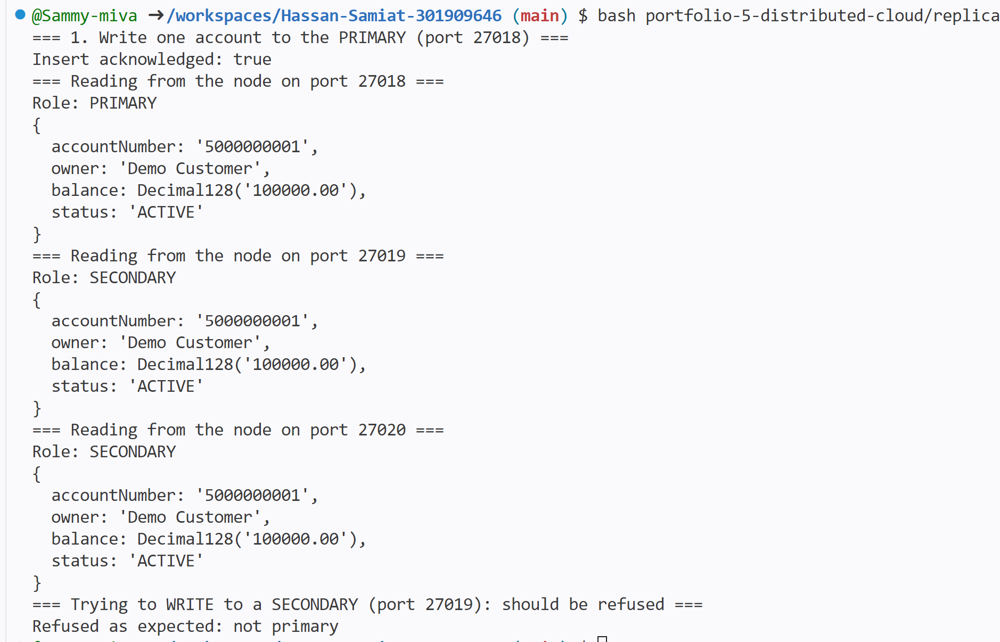
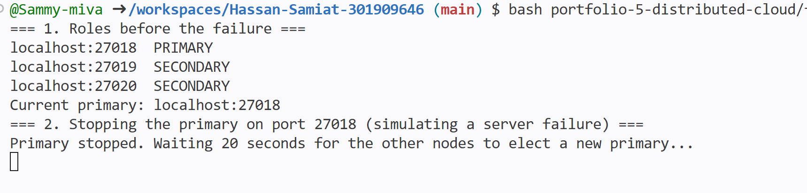

# Portfolio 5: Distributed and Cloud Database Exercise

## Purpose
This portfolio shows how the SamyPay database could be made more available and
reliable by running it on several servers instead of just one . I built and tested a MongoDB
replica set (replication and failover), and I discuss sharding, consistency
and cloud deployment for SamyPay.  MongoDB was used because it was set up earlier in portfolio 4.

## Environment
- Database: MongoDB 8.0 Community Edition
- Where it runs: GitHub Codespaces (one Linux machine)
- Replica set name: `samypayRS`, with three nodes on ports 27018, 27019 and 27020
- Database used for the tests: `samypay_rs`

## Part 1: Replication (building the replica set)
A replica set is a group of MongoDB servers that keep copies of the same data.
One node is the PRIMARY and accepts all writes. The others are SECONDARIES and
copy every change from the primary.

I started three nodes, each with its own data folder, and joined them with
`rs.initiate()` in `rs-init.js`:
```
mkdir -p ~/rs/node1 ~/rs/node2 ~/rs/node3
mongod --replSet samypayRS --port 27018 --dbpath ~/rs/node1 --bind_ip localhost --fork --logpath /tmp/rs1.log
mongod --replSet samypayRS --port 27019 --dbpath ~/rs/node2 --bind_ip localhost --fork --logpath /tmp/rs2.log
mongod --replSet samypayRS --port 27020 --dbpath ~/rs/node3 --bind_ip localhost --fork --logpath /tmp/rs3.log
mongosh --port 27018 --quiet --file portfolio-5-distributed-cloud/rs-init.js
```

| Node | Role |
|---|---|
| localhost:27018 | PRIMARY |
| localhost:27019 | SECONDARY |
| localhost:27020 | SECONDARY |


## Part 2: Replication test
The script `replication-demo.sh` (output in `replication-output.txt`) wrote one
account to the primary and then read it from each node.

| Test | Result |
|---|---|
| Write account 5000000001 (balance 100,000) to the primary with `w: majority` | Acknowledged |
| Read it from ports 27018, 27019 and 27020 | All three returned the same document |
| Write to a secondary (port 27019) | Refused, because only the primary accepts writes 

**What it shows:** a write made once on the primary appeared on every node
automatically, so each node holds a full copy of the data. Allowing writes on
only one node keeps the copies consistent. The `w: majority` setting means the
write only counts as done after most nodes (two of three) have it.



## Part 3: Failover (availability)
The script `failover-demo.sh` (output in `failover-output.txt`) simulated a
server failure by shutting down the primary on port 27018.

| Stage | What happened |
|---|---|
| Before | 27018 PRIMARY, 27019 and 27020 SECONDARY |
| Primary stopped | 27018 became unreachable |
| After about 20 seconds | The remaining nodes elected port 27019 as the new PRIMARY, with no action from me |
| Write with one node down | A new account (5000000002) was written and acknowledged 
| Node 27018 restarted | It rejoined the set as a SECONDARY 
| Read from the restarted node | It held both accounts, including the one written while it was down |

**What it shows:** the database stayed available after a node failed, because
the other nodes elected a new primary automatically. The failed node recovered
by copying the changes it missed.




## Discussion

### Availability and how elections work
Each node has one vote. A new primary needs a majority of the votes, which is
two out of three. With one node down, the other two can still elect a primary
and still satisfy `w: majority`, so SamyPay could keep taking deposits and
transfers. If two nodes were down, the remaining node could not win an election,
so there would be no primary and no writes and Samypay will not be able to taje deposits or transfers  although it could still serve
reads. I did not test the two-node failure.

### Consistency (the CAP idea)
The CAP idea says that when a network breaks a distributed database into parts,
it must choose between consistency (every reader sees the latest data) and
availability (every request gets an answer). MongoDB's default behaviour
favours consistency: during a partition, only the side holding a majority can
accept writes. For a bank this is the right choice, because showing a wrong
balance or accepting a withdrawal twice is worse than being briefly unable to
write.

Reads can be configured differently. Reading from a secondary can return data
that is slightly behind the primary, which is acceptable for something like a
transaction history screen but not for checking a balance before a withdrawal.
In my test, the secondary reads returned the data immediately, but that was a
small, quiet system and does not prove that lag never happens.

### Sharding (discussed, not implemented)
Replication copies the same data to every node. Sharding splits the data so
that each server holds only part of it. It is used when the data is too large
for one server or too busy for one primary.

For SamyPay, the `transactions` collection would be the first candidate, since
it grows without limit. The choice of shard key matters:

| Shard key | Effect |
|---|---|
| `createdAt` | Poor. Every new transaction has the newest date, so one shard takes all the writes. |
| `fromAccount` (hashed) | Good for spreading writes evenly. A customer's history is still found by looking in the shards that hold their account. |
| `customerId` | Keeps one customer's data together, but a very busy customer could overload one shard. |

I would test a hashed account number first, but I did not build a sharded
cluster. A real one needs config servers and query routers (`mongos`) as well
as the shards, and each shard would itself be a replica set.

### Cloud deployment (discussed, not implemented)
A real SamyPay deployment would place each replica set node in a different
server or availability zone, so that one machine or building failing does not
take down the whole set. Managed services such as MongoDB Atlas or a managed
PostgreSQL service handle replication, backups and failover for the customer.
I did not deploy to a cloud service in this portfolio.

### How this applies to the rest of SamyPay
| Part of SamyPay | Suitable setup |
|---|---|
| Account balances and transfers (PostgreSQL, Portfolios 1 to 3) | A primary with a standby copy for failover. Writes always go to the primary. |
| Customer profiles and transaction history (MongoDB, Portfolio 4) | A replica set for availability, and sharding later as history grows |
| Reports and statements | Reads from a secondary, to keep load off the primary |

## Limitations
- **All three nodes run on the same Codespace.** This shows how replication and
  failover work, but it gives no real protection, because if the Codespace
  fails, all three nodes fail together.
- Only one failure was tested (one node down). Two nodes failing, and network
  partitions between nodes, were not tested.
- Sharding and cloud deployment are discussed only.
- The test data is a handful of demo documents, so nothing was measured about
  replication delay or performance.
- The PostgreSQL side of SamyPay was not replicated. I did not set up streaming
  replication for it.

## Files in this folder
- `rs-init.js`: joins the three nodes into a replica set
- `replication-demo.sh` and `replication-output.txt`: the replication test
- `failover-demo.sh` and `failover-output.txt`: the failover test
- `README.md`: this document
- screenshots:  `replication-demo.png`, `failover-roles.png`.